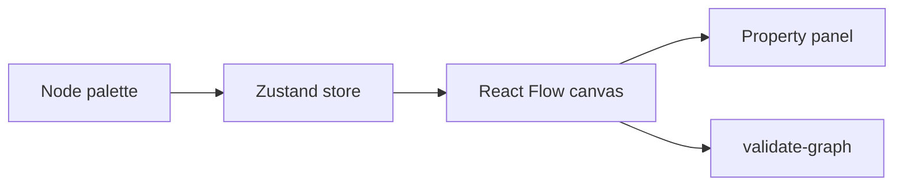

# 05-workflow architecture

Visual workflow editor. Canvas state via Zustand + @xyflow/react; validation via pure helpers + Zod export schema.

Standalone on port **5005**; Module Federation remote `workflow/App`.
